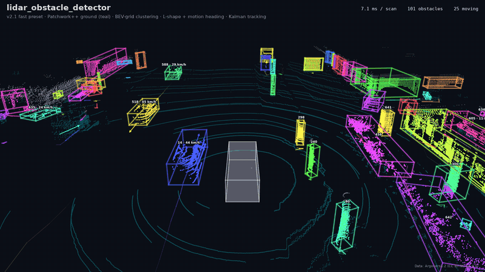
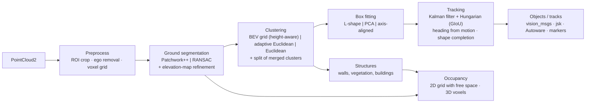

# lidar_obstacle_detector

Real-time 3D LiDAR obstacle detection and tracking for ROS 1 and ROS 2: ground segmentation,
clustering, oriented bounding boxes, multi-object tracking with velocities, and occupancy grids.
No training data, no GPU, a few milliseconds per scan.

[](https://github.com/SS47816/lidar_obstacle_detector/actions/workflows/ci.yml)


[](LICENSE)


<p align="center">
  
</p>
<p align="center"><sub>v2 <code>fast</code> preset on an Argoverse 2 drive. Colour = track ID; labels show ID and speed.
Data: <a href="https://www.argoverse.org/av2.html">Argoverse 2</a> (CC BY-NC-SA 4.0).</sub></p>

## Highlights (v2.1)

<!-- HIGHLIGHTS:BEGIN -->
- **3.7× faster than v1**: 7.5 ms per ~95k-point scan on one CPU core
  (Argoverse 2), 2.7 ms on nuScenes.
- **7× fewer ID switches** (IDF1\* 0.20 → 0.73), with a velocity
  estimate for every tracked object.
- **Robust ground segmentation on slopes and kerbs**: object points wrongly removed as ground drop
  from 25% to 5% ([Patchwork++](https://github.com/url-kaist/patchwork-plusplus) + elevation-map refinement).
- **Higher recall, fewer merged objects**: recall@1m 0.53 → 0.66 (`fast`) / 0.70 (`accurate`),
  under-segmentation 28% → 10% / 9% on Argoverse 2. Clusters are split at
  height gaps and at object-size limits; walls and vegetation are reported as structures.
- **Boxes that point where objects go**: moving vehicles take their heading from the tracked
  motion (error 90° → 14°, front/back resolved), and partially visible
  vehicles keep the full size seen earlier in their track.
- **Occupancy outputs**: a `nav_msgs/OccupancyGrid` with ray-cast free space and 3D occupied voxels,
  ready for nav2 or Autoware costmaps.
- **ROS 1 and ROS 2** nodes on one ROS-agnostic C++ library, live-tunable parameters, and outputs
  for `vision_msgs`, Autoware, jsk and RViz.
- **Reproducible**: a public benchmark on Argoverse 2 and nuScenes, unit tests, CI for Noetic, Humble
  and Jazzy, and a one-command [pixi](https://pixi.sh) setup with no system ROS install needed.
<!-- HIGHLIGHTS:END -->

The v1 code remains available at the [`v1-ros1-legacy`](../../tree/v1-ros1-legacy) tag; see the
[changelog](CHANGELOG.md) for everything that changed, including the v1 bugs that were fixed.

## Pipeline



Clusters too large to be an object (by default longer than 16 m or wider than 5 m, after an attempt
to split them) are reported as **structures**. They don't appear in the object and track outputs,
but they do appear in the occupancy outputs and as grey markers, so a planner still sees them.

| Preset | Ground | Clustering | Boxes | Tracking | Use it for |
|---|---|---|---|---|---|
| `fast` (default) | Patchwork++ | BEV grid | L-shape | KF + motion heading | most robots and vehicles |
| `accurate` | Patchwork++ | adaptive Euclidean | L-shape | KF + motion heading | best recall, 2–4× the compute of `fast` |
| `legacy` | RANSAC | Euclidean | axis-aligned | KF | v1 behaviour (without its bugs); no structures or occupancy |

## Benchmark

Class-agnostic results on 15 Argoverse 2 validation logs (2 × 32-beam lidar, 10 Hz) and the
10 nuScenes-mini scenes (32-beam, 20 Hz). The ROI is ±40 m; objects are vehicles, pedestrians and
cyclists with at least 5 lidar points. Runtime is the mean per scan on one core of an
i9-12900K (box fitting uses OpenMP). "\*" metrics ignore predictions far from any labelled object,
since the detector also (correctly) reports unlabelled walls, poles and vegetation.

<!-- BENCHMARK:BEGIN -->
| Dataset | Pipeline | Recall@1m | Recall@IoU.3 | Under-seg | IDF1* | ID switches | Obj. pts lost to ground | Runtime [ms] |
|---|---|---|---|---|---|---|---|---|
| Argoverse 2 | v1 | 0.53 | 0.42 | 28% | 0.20 | 11,822 | 25% | 27.9 |
| Argoverse 2 | v2 `fast` | 0.66 | 0.62 | 10% | 0.73 | 1,725 | 5% | 7.5 |
| Argoverse 2 | v2 `accurate` | 0.70 | 0.63 | 9% | 0.71 | 1,749 | 5% | 31.8 |
| nuScenes | v1 | 0.38 | 0.31 | 9% | 0.35 | 1,476 | 6% | 6.6 |
| nuScenes | v2 `fast` | 0.42 | 0.36 | 11% | 0.58 | 363 | 6% | 2.7 |
| nuScenes | v2 `accurate` | 0.41 | 0.34 | 8% | 0.57 | 390 | 6% | 6.1 |
| nuScenes | v2 `accurate`, sparse-lidar tuning | 0.57 | 0.41 | 10% | 0.65 | 626 | 6% | – |
<!-- BENCHMARK:END -->

The sparse-lidar row uses `cluster_min_size: 5, cluster_range_gain: 0.04`, recommended for 32-beam
sensors (see [Parameters](#parameters)). Ablations, a parameter sensitivity study and every
metric are in [docs/benchmarks.md](docs/benchmarks.md).

## Installation

### ROS 2 (Humble, Jazzy)

```bash
cd ~/ros2_ws/src
git clone https://github.com/SS47816/lidar_obstacle_detector.git
cd ..
rosdep install --from-paths src --ignore-src -r -y
colcon build --packages-select lidar_obstacle_detector --cmake-args -DCMAKE_BUILD_TYPE=Release
source install/setup.bash
```

### ROS 1 (Noetic)

```bash
cd ~/catkin_ws/src
git clone https://github.com/SS47816/lidar_obstacle_detector.git
cd ..
rosdep install --from-paths src --ignore-src -r -y
catkin_make -DCMAKE_BUILD_TYPE=Release   # or: catkin build
source devel/setup.bash
```

`autoware_msgs` (ROS 1) and `autoware_perception_msgs` (ROS 2) are optional. When they are
found at build time, the node also publishes Autoware objects.

### Without a system ROS install (pixi)

[pixi](https://pixi.sh) installs ROS from [RoboStack](https://robostack.github.io) into the
repository folder. It needs no root access and works on any Linux distribution:

```bash
pixi run -e jazzy build      # ROS 2 Jazzy (colcon), then: pixi shell -e jazzy
pixi run -e noetic build     # ROS 1 Noetic (catkin build)
pixi run -e core test        # the ROS-agnostic library + unit tests
```

## Usage

### ROS 2

```bash
ros2 launch lidar_obstacle_detector obstacle_detector.launch.py points:=/velodyne_points
# options: preset:=fast|accurate|legacy  tracking_frame:=odom  target_frame:=base_link  rviz:=true
```

| Topic | Type | |
|---|---|---|
| `points` (input, remap it) | `sensor_msgs/PointCloud2` | |
| `~/detections` | `vision_msgs/Detection3DArray` | boxes; `id` is the track id |
| `~/markers` | `visualization_msgs/MarkerArray` | boxes, ids, velocity arrows |
| `~/objects` | `autoware_perception_msgs/DetectedObjects` | if built with Autoware msgs |
| `~/occupancy` | `nav_msgs/OccupancyGrid` | free / occupied / unknown, lidar frame |
| `~/occupancy_voxels` | `sensor_msgs/PointCloud2` | occupied voxel centres |
| `~/cloud_ground`, `~/cloud_obstacles` | `sensor_msgs/PointCloud2` | |

Point cloud and occupancy topics are only computed into messages when something subscribes.

All parameters can be changed while the node runs, using `rqt_reconfigure` or
`ros2 param set /obstacle_detector cluster_threshold 0.5`. Defaults are in
[config/obstacle_detector.yaml](config/obstacle_detector.yaml).

### ROS 1

```bash
roslaunch lidar_obstacle_detector mai_city.launch
```

The v1 topic parameters (`lidar_points_topic`, `cloud_ground_topic`, `cloud_clusters_topic`,
`jsk_bboxes_topic`, `autoware_objects_topic`, `bbox_target_frame`) still work. Output is published as
`jsk_recognition_msgs/BoundingBoxArray` (`label` is the track id), RViz markers and
`autoware_msgs/DetectedObjectArray`, plus `nav_msgs/OccupancyGrid` and occupied voxels. Every
algorithm parameter is exposed through `dynamic_reconfigure`. The new optional parameters are
`preset`, `tracking_frame`, `markers_topic`, `occupancy_topic` and `occupancy_voxels_topic`.

### Demo with the MAI City dataset

1. Download the bags from the [MAI City dataset](https://www.ipb.uni-bonn.de/data/mai-city-dataset/).
2. Play them:
   - **ROS 1:** `roslaunch lidar_obstacle_detector mai_city.launch`, then `rosbag play 00.bag`.
   - **ROS 2:** convert the bag first with `pip install rosbags && rosbags-convert --src 00.bag --dst 00`,
     then run `ros2 launch lidar_obstacle_detector mai_city.launch.py` and
     `ros2 bag play 00 --clock`.


### Use the library without ROS

```cpp
#include <lidar_obstacle_detector/obstacle_detector.hpp>
using namespace lidar_obstacle_detector;

ObstacleDetector<pcl::PointXYZI> detector(PipelineConfig::preset("fast"));
auto result = detector.process(cloud, stamp_seconds /*, odom_T_lidar (optional) */);
for (const Box &b : result.boxes) { /* b.id, b.center, b.size, b.yaw, b.velocity, b.heading_known */ }
// result.structures / structure_boxes, result.occupancy (2D grid), result.occupied_voxels
```

## Parameters

Every parameter has the same name in ROS 1, ROS 2 and the benchmark CLI. The full list, with
ranges, is in [core/src/config.cpp](core/src/config.cpp). The ones you are most likely to change:

| Parameter | Default | Meaning |
|---|---|---|
| `roi_{min,max}_{x,y,z}` | -30/70, ±30, -2.5/1 | region of interest in the lidar frame (x forward, z up) |
| `ego_{min,max}_{x,y,z}` | | box around your vehicle; its points are removed |
| `sensor_height` | 1.73 | lidar height above the ground [m], used by Patchwork++ |
| `voxel_grid_size` | 0.2 | downsampling leaf size [m] (0 = off) |
| `cluster_threshold` | 0.6 | max gap between points of one object [m] |
| `cluster_min_size` | 10 | minimum points per obstacle |
| `tracking_frame` | "" | fixed frame (e.g. `odom`) for tracking, so velocities are not relative to the ego vehicle |
| `object_max_length`, `object_max_width` | 16, 5 | larger clusters are split, or reported as structures [m] |
| `occupancy_min_height`, `occupancy_max_height` | 0.2, 2.5 | height band above the local ground that counts as occupied [m] |

**Tuning for your lidar.** With sparse sensors (32 beams or fewer, e.g. nuScenes), use
`cluster_min_size: 5` and `cluster_range_gain: 0.04` to keep small and distant objects. On
nuScenes this raises recall@1m from 0.42 to 0.55 (`fast`) and from 0.41 to 0.57 (`accurate`); see the sensitivity table in
[docs/benchmarks.md](docs/benchmarks.md). With dense 64- or 128-beam sensors, keep the defaults:
the same settings over-segment there.

## Reproducing the benchmark

```bash
pixi run -e core build
# Argoverse 2 (no account needed) and nuScenes (free account) -> common format
pixi run -e core python -I tools/python/lod_bench/prepare_av2.py --root ~/datasets/av2/sensor/val --out ~/datasets/lod_bench/av2
pixi run -e core python -I tools/python/lod_bench/prepare_nuscenes.py --root ~/datasets/nuscenes --out ~/datasets/lod_bench/nuscenes
# run + evaluate a preset, or the v1 baseline (--pipeline legacy)
pixi run -e core python -I tools/python/lod_bench/run.py --data ~/datasets/lod_bench/av2 --runs ~/datasets/lod_bench/runs --name fast --preset fast
```

To replay a converted sequence into ROS 2, use
`python tools/python/lod_bench/replay_ros2.py --seq <dir>`, which publishes the point clouds
and odometry TF.

## Roadmap

- [x] ROS 2 support
- [x] Multi-object tracking with velocity estimation
- [x] L-shape box fitting
- [x] Robust ground segmentation (Patchwork++)
- [x] Heading from motion, shape completion, height-aware clustering
- [x] Occupancy outputs (2D grid with free space, 3D voxels)
- [ ] Optional GPU detectors: NVIDIA CUDA-PointPillars / CUDA-CenterPoint (TensorRT), fused with the clustering detector for unknown objects
- [ ] Release on the ROS buildfarm (`apt install ros-<distro>-lidar-obstacle-detector`)
- [ ] Python bindings
- [ ] Motion undistortion of rotating lidar scans

## Contributing

Issues and pull requests are welcome. Please run `pre-commit run --all-files` (clang-format,
ruff) and `pixi run -e core test` before opening a PR. If a change affects detection quality,
include the benchmark numbers.

## Citation

If you use this package, please cite it (see [CITATION.cff](CITATION.cff)). If you use the
`fast` or `accurate` presets, also cite Patchwork++ (Lee et al., IROS 2022) and the L-shape
fitting paper (Zhang et al., IV 2017).

## License

MIT, see [LICENSE](LICENSE). The vendored Patchwork++ code in
[third_party/patchworkpp](third_party/patchworkpp) is BSD-2-Clause.
