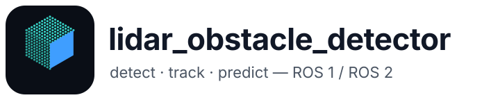
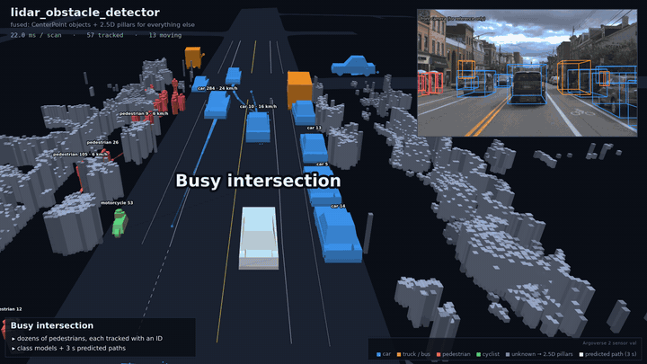
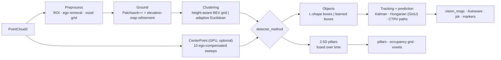
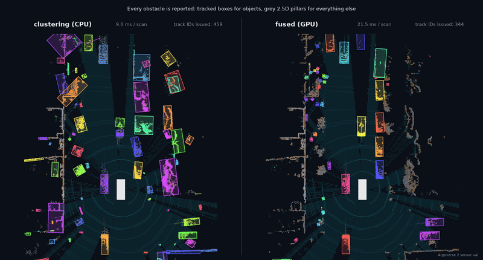

<p align="center">
  <picture>
    <source media="(prefers-color-scheme: dark)" srcset="media/logo_dark.svg">
    
  </picture>
</p>

<p align="center">
  <b>Real-time 3D LiDAR perception for ROS 1 and ROS 2:</b> detect, track and predict every obstacle.<br>
  Model-free on a CPU, or fused with a GPU detector. Nothing unrecognised is dropped.
</p>

<p align="center">
  <a href="https://github.com/SS47816/lidar_obstacle_detector/actions/workflows/ci.yml"></a>
  
  
  
  
  <a href="LICENSE"></a>
  
</p>

<p align="center">
  
</p>
<p align="center"><sub><code>fused</code> mode on three Argoverse 2 drives. The camera is for reference only; detection uses
the lidar alone. Data: <a href="https://www.argoverse.org/av2.html">Argoverse 2</a> (CC BY-NC-SA 4.0).
Full-resolution video in the <a href="../../releases/latest">latest release</a>.</sub></p>

## Why lidar_obstacle_detector?

<!-- HIGHLIGHTS:BEGIN -->
- **Fast.** 10.4 ms per 95k-point scan on one CPU core (Argoverse 2),
  3.4 ms on nuScenes. That includes ground segmentation, clustering,
  tracking and occupancy.
- **Nothing is dropped.** Recognised objects become tracked boxes. Everything else (walls, poles,
  debris, an overturned bin) becomes **2.5D pillars**: on Argoverse 2, 99% of labelled objects
  are covered by a box or by pillars.
- **Stable.** Pillars are fused over time, which cuts their scan-to-scan flicker from 37% to 13%.
  Boxes keep their shape and heading along a track.
- **Tracks with velocity and a future.** A Kalman filter with GIoU association tracks every
  object. Moving objects take their heading from their motion and get a **3 s predicted path**
  (constant turn rate and velocity).
- **Optional GPU detector.** NVIDIA CUDA-CenterPoint (TensorRT) with **multi-sweep input** adds
  class labels and precise boxes:
  - recall@1m 0.91 on Argoverse 2 and 0.98 on nuScenes val
  - IDF1\* 0.86 / 0.88
  - 25.5 ms per scan in `fused` mode on an RTX 3090 Ti
- **Robust ground segmentation.** [Patchwork++](https://github.com/url-kaist/patchwork-plusplus)
  plus an elevation-map refinement. Only 5% of object points are lost to the ground on hilly
  Pittsburgh streets.
- **Drop-in for your stack.** ROS 1 and ROS 2 nodes, live-tunable parameters, and outputs for
  `vision_msgs`, Autoware (`DetectedObjects`, `PredictedObjects`), jsk, nav2 occupancy grids,
  RViz and Foxglove.
- **Reproducible.** A public benchmark on Argoverse 2 and nuScenes, unit tests, CI on Noetic,
  Humble and Jazzy, and a one-command [pixi](https://pixi.sh) setup with no system ROS needed.
<!-- HIGHLIGHTS:END -->

## Quick start

```bash
# ROS 2 (Humble / Jazzy), in your workspace's src/
git clone https://github.com/SS47816/lidar_obstacle_detector.git && cd ..
rosdep install --from-paths src --ignore-src -r -y && colcon build --cmake-args -DCMAKE_BUILD_TYPE=Release
source install/setup.bash
ros2 launch lidar_obstacle_detector obstacle_detector.launch.py points:=/your/points tracking_frame:=odom rviz:=true
```

No ROS installed? `pixi run -e jazzy build` builds everything, ROS 2 Jazzy included, inside the
repository folder (see [Installation](#installation)).

## Detector modes

Two detectors, three ways to combine them (`detector_method`):

| Mode | Objects (tracked boxes) | Everything else | Needs |
|---|---|---|---|
| `clustering` (default) | every obstacle, class `unknown` | also reported as 2.5D pillars | CPU |
| `learning` | 10 nuScenes classes: car, truck, bus, trailer, construction vehicle, pedestrian, bicycle, motorcycle, barrier, traffic cone | **not reported** | NVIDIA GPU |
| `fused` | the 10 classes, each absorbing the clusters that belong to it | 2.5D pillars, untracked | NVIDIA GPU |

> [!WARNING]
> `learning` only reports what the network was trained on. A fallen tree, a wheelchair or a
> shopping trolley is invisible to it. Use `fused` on a robot that has to stop for them.

`fused` follows the output model used by production AV stacks: what the network recognises is
tracked and predicted as an object, and what it doesn't is still there as occupied space.

<!-- MODES:BEGIN -->
| Argoverse 2, 15 val logs | Recall@1m | Coverage | IDF1\* | ID switches | Moving heading err. | Runtime |
|---|---|---|---|---|---|---|
| `clustering` (`fast`, CPU) | 0.66 | 99.5% | 0.73 | 1,725 | 14° | 10.4 ms |
| `learning` (CenterPoint, 10 sweeps) | 0.91 | 94.7% | 0.86 | 1,024 | 2.4° | 23.7 ms |
| `fused` | 0.91 | 99.0% | 0.86 | 1,034 | 2.4° | 25.5 ms |
<!-- MODES:END -->

**Coverage** is the share of labelled objects that are reported, either as a box or by pillars
in their footprint. Recall@1m counts boxes only.

## Outputs

| ROS 2 topic | Type | Content |
|---|---|---|
| `~/detections` | `vision_msgs/Detection3DArray` | boxes, class, score; `id` is the track id |
| `~/objects` | `autoware_perception_msgs/DetectedObjects` | boxes with velocity and heading availability |
| `~/predicted_objects` | `autoware_perception_msgs/PredictedObjects` | tracked objects with their 3 s predicted path |
| `~/pillars` | `sensor_msgs/PointCloud2` | 2.5D pillars: `x, y, z` (top), `z_min` (ground), `observed` |
| `~/occupancy` | `nav_msgs/OccupancyGrid` | free / occupied / unknown (ray-cast), for nav2 or costmaps |
| `~/occupancy_voxels` | `sensor_msgs/PointCloud2` | occupied 3D voxels |
| `~/markers` | `visualization_msgs/MarkerArray` | class models, boxes, ids, velocities, predicted paths, pillars |
| `~/cloud_ground`, `~/cloud_obstacles` | `sensor_msgs/PointCloud2` | segmented input |

Autoware topics are published when `autoware_perception_msgs` is found at build time. Clouds,
pillars and occupancy are only converted into messages when something subscribes. On ROS 1 the
node publishes the same content as jsk boxes, `autoware_msgs/DetectedObjectArray`, markers,
pillars and occupancy (see [ROS 1](#ros-1)).

## Try it in Foxglove

[`config/foxglove_layout.json`](config/foxglove_layout.json) is a ready-made
[Foxglove](https://foxglove.dev) layout: 3D view with models, pillars and paths, the camera, and
the detections. Download the demo recording `lidar_obstacle_detector_demo.mcap` from the
[latest release](../../releases/latest) (the ROS 2 node in `clustering` mode on an Argoverse 2
drive), open it in [app.foxglove.dev](https://app.foxglove.dev) (no install needed) and import
the layout. To record your own, run the node with
`mesh_uri:=https://raw.githubusercontent.com/SS47816/lidar_obstacle_detector/main/meshes/` so the
models load in the browser.

## Pipeline



| Preset | Ground | Clustering | Boxes | Use it for |
|---|---|---|---|---|
| `fast` (default) | Patchwork++ | BEV grid | L-shape | most robots and vehicles |
| `accurate` | Patchwork++ | adaptive Euclidean | L-shape | highest clustering recall, 2–3× the compute |
| `legacy` | RANSAC | Euclidean | axis-aligned | the classic pipeline; no pillars or occupancy |

## Benchmark

Class-agnostic results on 15 Argoverse 2 validation logs (2 × 32-beam lidar, 10 Hz, 2,350 scans)
and the 10 nuScenes-mini scenes (32-beam, 20 Hz). The ROI is ±40 m. Objects are vehicles,
pedestrians and cyclists with at least 5 lidar points. CPU timings are on one core of an
i9-12900K; GPU rows add an RTX 3090 Ti. "\*" metrics ignore predictions far from any labelled
object, because walls, poles and vegetation are correctly reported but not labelled.

<!-- BENCHMARK:BEGIN -->
| Dataset | Mode | Recall@1m | Recall@IoU.3 | Coverage | Under-seg | IDF1\* | ID switches | Obj. pts lost to ground | Runtime [ms] |
|---|---|---|---|---|---|---|---|---|---|
| Argoverse 2 | `legacy` (classic) | 0.53 | 0.42 | 72.7% | 28% | 0.51 | 4,653 | 26% | 30.5 |
| Argoverse 2 | `fast` | 0.66 | 0.62 | 99.5% | 10% | 0.73 | 1,725 | 5% | 10.4 |
| Argoverse 2 | `accurate` | 0.70 | 0.63 | 99.5% | 9% | 0.71 | 1,749 | 5% | 32.2 |
| Argoverse 2 | `learning` (GPU) | 0.91 | 0.91 | 94.7% | 2% | 0.86 | 1,024 | 5% | 23.7 |
| Argoverse 2 | `fused` (GPU) | 0.91 | 0.91 | 99.0% | 2% | 0.86 | 1,034 | 5% | 25.5 |
| nuScenes mini | `legacy` (classic) | 0.38 | 0.31 | 58.1% | 9% | 0.57 | 425 | 5% | 6.7 |
| nuScenes mini | `fast` | 0.42 | 0.36 | 98.3% | 11% | 0.58 | 363 | 6% | 3.4 |
| nuScenes mini | `accurate` | 0.41 | 0.34 | 98.3% | 8% | 0.57 | 390 | 6% | 6.8 |
| nuScenes val | `fast` | 0.38 | 0.32 | 99.1% | 17% | 0.55 | 135 | 5% | 3.5 |
| nuScenes val | `learning` (GPU) | 0.98 | 0.96 | 99.0% | 1% | 0.88 | 77 | 5% | 14.9 |
| nuScenes val | `fused` (GPU) | 0.98 | 0.96 | 99.8% | 1% | 0.88 | 82 | 5% | 16.0 |
<!-- BENCHMARK:END -->

CenterPoint was trained on nuScenes, so on nuScenes it is scored on the two mini **val** scenes
only. On Argoverse 2, a lidar setup and city it has never seen, it is still far ahead of
clustering. Multi-sweep input and every other component are ablated in
[docs/benchmarks.md](docs/benchmarks.md), which also explains each metric.

<p align="center">
  
</p>
<p align="center"><sub>The same drive, <code>clustering</code> (left, CPU) vs <code>fused</code> (right, GPU), seen from above.</sub></p>

## Installation

### ROS 2 (Humble, Jazzy)

```bash
cd ~/ros2_ws/src
git clone https://github.com/SS47816/lidar_obstacle_detector.git
cd ..
rosdep install --from-paths src --ignore-src -r -y
colcon build --packages-select lidar_obstacle_detector --cmake-args -DCMAKE_BUILD_TYPE=Release
source install/setup.bash
```

### ROS 1 (Noetic)

```bash
cd ~/catkin_ws/src
git clone https://github.com/SS47816/lidar_obstacle_detector.git
cd ..
rosdep install --from-paths src --ignore-src -r -y
catkin_make -DCMAKE_BUILD_TYPE=Release   # or: catkin build
source devel/setup.bash
```

### Without a system ROS install (pixi)

[pixi](https://pixi.sh) installs ROS from [RoboStack](https://robostack.github.io) into the
repository folder. It needs no root access and works on any Linux distribution:

```bash
pixi run -e jazzy build      # ROS 2 Jazzy (colcon), then: pixi shell -e jazzy
pixi run -e noetic build     # ROS 1 Noetic (catkin build)
pixi run -e core test        # the ROS-agnostic library + unit tests
pixi run -e gpu gpu-test     # with CUDA-CenterPoint (NVIDIA driver >= 570)
```

### GPU detector (optional)

You need an NVIDIA GPU (Ampere or newer, or Jetson Orin), CUDA 11.4–13, TensorRT ≥ 10 and
protobuf. Then:

```bash
colcon build --packages-select lidar_obstacle_detector --cmake-args -DLOD_WITH_TENSORRT=ON
```

CMake downloads NVIDIA's prebuilt sparse-convolution library and the ONNX models, and checks
their SHA-256. The first run builds a TensorRT engine for your GPU (about a minute) and caches it
in `~/.cache/lidar_obstacle_detector`. Set `detector_method: fused`, and set `sensor_height` to
your lidar's height above the ground: the network expects nuScenes' mounting height, and the
input is shifted to match. Multi-sweep input needs `tracking_frame` (e.g. `odom`). Without a
TensorRT build, the GPU modes are rejected with an error and the node keeps running.

## Usage

### ROS 2

```bash
ros2 launch lidar_obstacle_detector obstacle_detector.launch.py points:=/velodyne_points
# options: preset:=fast|accurate|legacy  tracking_frame:=odom  target_frame:=base_link  rviz:=true
```

Every parameter can be changed while the node runs, with `rqt_reconfigure` or
`ros2 param set /obstacle_detector cluster_threshold 0.5`. The defaults are in
[config/obstacle_detector.yaml](config/obstacle_detector.yaml).

### ROS 1

```bash
roslaunch lidar_obstacle_detector mai_city.launch
```

Topics are set with the parameters `lidar_points_topic`, `cloud_ground_topic`,
`cloud_clusters_topic`, `jsk_bboxes_topic`, `autoware_objects_topic`, `markers_topic`,
`occupancy_topic`, `occupancy_voxels_topic` and `pillars_topic`. Boxes are published in
`bbox_target_frame`. Every algorithm parameter is exposed through `dynamic_reconfigure`.

### Demo with the MAI City dataset

1. Download the bags from the [MAI City dataset](https://www.ipb.uni-bonn.de/data/mai-city-dataset/).
2. Play them:
   - **ROS 1:** `roslaunch lidar_obstacle_detector mai_city.launch`, then `rosbag play 00.bag`.
   - **ROS 2:** convert the bag first with `pip install rosbags && rosbags-convert --src 00.bag --dst 00`,
     then run `ros2 launch lidar_obstacle_detector mai_city.launch.py` and
     `ros2 bag play 00 --clock`.

You can also replay Argoverse 2 or nuScenes sequences into ROS 2 with
`tools/python/lod_bench/replay_ros2.py` (see [Reproducing the benchmark](#reproducing-the-benchmark)).

### C++ library (no ROS)

```cpp
#include <lidar_obstacle_detector/obstacle_detector.hpp>
using namespace lidar_obstacle_detector;

PipelineConfig cfg = PipelineConfig::preset("fast");
setParameter(&cfg, "detector_method", "fused");  // needs a TensorRT build
ObstacleDetector<pcl::PointXYZI> detector(cfg);

auto result = detector.process(cloud, stamp_seconds, odom_T_lidar);
for (const Box &b : result.boxes) {
  // b.id, b.label, b.score, b.center, b.size, b.yaw, b.velocity, b.predicted_path
}
// result.pillars (2.5D), result.occupancy (2D grid), result.occupied_voxels
```

`ObstacleDetector::setLearnedDetector()` plugs in your own network (any `LearnedDetector` that
returns labelled boxes). Fusion, tracking, prediction and the ROS outputs then work unchanged.

## Parameters

Every parameter has the same name in ROS 1, ROS 2 and the benchmark CLI. The full list, with
ranges, is in [core/src/config.cpp](core/src/config.cpp). The ones you are most likely to change:

| Parameter | Default | Meaning |
|---|---|---|
| `detector_method` | `clustering` | `clustering`, `learning` or `fused` (see [Detector modes](#detector-modes)) |
| `tracking_frame` | "" | fixed frame (e.g. `odom`). Velocities are then absolute, and multi-sweep input and pillar fusion turn on |
| `sensor_height` | 1.73 | lidar height above the ground [m] |
| `roi_{min,max}_{x,y,z}` | -30/70, ±30, -2.5/1 | region of interest in the lidar frame (x forward, z up) |
| `ego_{min,max}_{x,y,z}` | | box around your vehicle; its points are removed |
| `cluster_threshold` | 0.6 | max gap between points of one object [m] |
| `cluster_min_size` | 10 | minimum points per obstacle |
| `pillar_memory` | 2.0 | how long pillars are remembered when occluded [s] (0 = this scan only) |
| `prediction_horizon` | 3.0 | length of predicted paths [s] (0 = off) |
| `occupancy_min_height`, `occupancy_max_height` | 0.2, 2.5 | height band above the local ground that counts as occupied [m] |

**Tuning for your lidar.** With sparse sensors (32 beams or fewer, e.g. nuScenes), use
`cluster_min_size: 5` and `cluster_range_gain: 0.04` to keep small and distant objects. On
nuScenes this raises recall@1m from 0.42 to 0.55 (`fast`) and from 0.41 to 0.57 (`accurate`).
With dense 64- or 128-beam sensors, keep the
defaults. For many long trucks in clustering mode, try `cluster_track_guided: true`: it cuts
split trucks by a quarter, at a small cost in recall (see
[docs/benchmarks.md](docs/benchmarks.md)).

## Reproducing the benchmark

```bash
pixi run -e core build
# Argoverse 2 (no account needed) and nuScenes (free account) -> common format
pixi run -e core python -I tools/python/lod_bench/prepare_av2.py --root ~/datasets/av2/sensor/val --out ~/datasets/lod_bench/av2
pixi run -e core python -I tools/python/lod_bench/prepare_nuscenes.py --root ~/datasets/nuscenes --out ~/datasets/lod_bench/nuscenes
# run + evaluate a preset (--set key=value to change parameters)
pixi run -e core python -I tools/python/lod_bench/run.py --data ~/datasets/lod_bench/av2 --runs ~/datasets/lod_bench/runs --name fast --preset fast
```

The demo videos are rendered with `tools/python/lod_bench/render_showcase.py` (map, camera and
models) and `render_demo.py` (chase camera, bird's-eye comparison).

## Roadmap

- [x] ROS 2 support, multi-object tracking with velocities, L-shape boxes, Patchwork++
- [x] Occupancy grid and 2.5D pillars fused over time
- [x] NVIDIA CUDA-CenterPoint with multi-sweep input, and `fused` mode
- [x] Trajectory prediction (CTRV) with Autoware `PredictedObjects`
- [ ] Map-aware prediction (lane following)
- [ ] NVIDIA CUDA-PointPillars as a second learned backend
- [ ] Release on the ROS buildfarm (`apt install ros-<distro>-lidar-obstacle-detector`)
- [ ] Python bindings
- [ ] Motion undistortion of rotating lidar scans

The previous ROS 1-only release is still available at the
[`v1-ros1-legacy`](../../tree/v1-ros1-legacy) tag. See the [changelog](CHANGELOG.md) for
everything in 2.0.

## Contributing

Issues, discussions and pull requests are welcome; see [CONTRIBUTING.md](CONTRIBUTING.md). If
lidar_obstacle_detector is useful to you, a ⭐ helps others find it.

## Citation

If you use this package, please cite it (see [CITATION.cff](CITATION.cff)). Please also cite
Patchwork++ (Lee et al., IROS 2022), L-shape fitting (Zhang et al., IV 2017) and, for the GPU
modes, CenterPoint (Yin et al., CVPR 2021).

## License

MIT, see [LICENSE](LICENSE). Vendored code: Patchwork++ ([third_party/patchworkpp](third_party/patchworkpp),
BSD-2-Clause) and NVIDIA CUDA-CenterPoint ([third_party/cuda_centerpoint](third_party/cuda_centerpoint), MIT).
